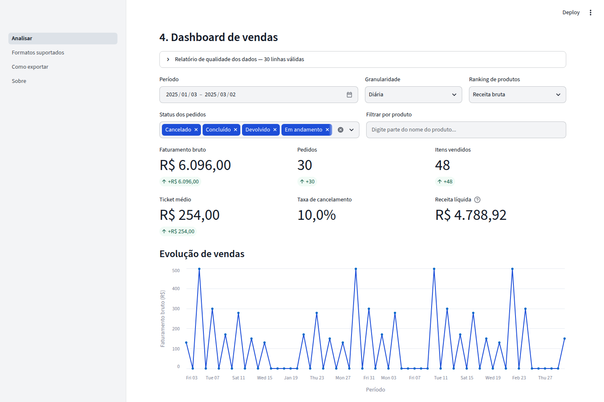

# Analisador de Relatórios de Marketplaces


[](https://github.com/Mpierredev/analisador-relatorios-marketplace/actions/workflows/ci.yml)

Aplicação web gratuita em Streamlit para validar, normalizar, diagnosticar e analisar relatórios de vendas exportados de marketplaces (Mercado Livre, Shopee e planilhas CSV/XLSX genéricas), transformando exportações brutas e heterogêneas em um dashboard interativo com exportação padronizada — **sem banco de dados, sem cadastro e com processamento integralmente em memória**.



---

## O problema que resolve

Vendedores de marketplaces exportam relatórios com pré-cabeçalhos de metadados, encodings variados (`UTF-8`, `UTF-8 BOM`, `UTF-16`, `Latin-1`/`cp1252`), separadores diferentes (`,`, `;`, tabulação), abas múltiplas em `.xlsx`, valores monetários no padrão brasileiro (`R$ 1.234,56`) ou internacional (`1234.56`), datas por extenso em português/espanhol e status inconsistentes.

Em vez de montar planilhas manuais a cada fechamento, a ferramenta aplica um fluxo único e explícito:

```text
Selecionar formato -> Enviar arquivo (.csv/.xlsx) -> Validar / mapear -> Gerar dashboard -> Exportar CSV/Excel
```

---

## Demo ao vivo e amostras prontas

- **Deploy público (Streamlit Community Cloud):** em preparação para a etapa de publicação (`Etapa 11`). Assim que publicado, a URL ficará disponível neste espaço.
- **Execução instantânea com amostras incluídas:** após iniciar a aplicação localmente com `streamlit run app.py`, a página **Analisar** oferece botões de carregamento em **1 clique** para três planilhas sintéticas localizadas em [`samples/`](samples/):
  - [`exemplo_mercado_livre.xlsx`](samples/exemplo_mercado_livre.xlsx) — planilha com metadados iniciais, datas por extenso e valores em BRL;
  - [`exemplo_generico.csv`](samples/exemplo_generico.csv) — CSV separado por `;` para demonstração do mapeamento manual assistido;
  - [`exemplo_shopee_experimental.xlsx`](samples/exemplo_shopee_experimental.xlsx) — planilha sintética baseada na estrutura documentada de pedidos da Shopee.

---

## Recursos principais

- **Ingestão resiliente em memória:** lê `.csv` e `.xlsx` (com seleção explícita de aba quando há múltiplas abas), detecta encoding, separador e a linha real de cabeçalho mesmo quando há linhas de título ou resumo no topo da planilha.
- **Detecção automática e validação com trava explícita:** pontua compatibilidade com os adapters registrados, detalha colunas obrigatórias/opcionais encontradas e mantém o botão **Gerar dashboard** bloqueado até que o arquivo seja validado ou mapeado manualmente.
- **Mapeamento manual assistido:** planilhas fora do padrão conhecido são mapeadas com sugestões automáticas baseadas em similaridade de cabeçalhos e inferência de tipo de coluna (data, quantidade inteira, valor monetário, identificador).
- **Normalização e relatório de qualidade:** converte moeda em centavos inteiros (`int64`), datas com `dayfirst` explícito para `America/Sao_Paulo`, deriva receita bruta e líquida (indicando claramente quando é informada vs. derivada) e aponta duplicidades, nulos, datas inválidas, quantidades não positivas e *outliers* por IQR.
- **Dashboard interativo:** cartões de KPI com comparativo contra o período anterior equivalente, séries temporais (diária, semanal e mensal), ranking de produtos por receita ou quantidade, Curva ABC (Pareto), distribuição de status e filtros dinâmicos.
- **Exportação gerencial e ajuda integrada:** gera CSV normalizado (com BOM opcional compatível com Excel em português) e workbook Excel formatado com cinco abas (`Resumo KPIs`, `Série Temporal`, `Top Produtos`, `Curva ABC` e `Status e Qualidade`), além das páginas **Formatos suportados** e **Como exportar**.

---

## Formatos suportados

Os adapters são **compatíveis com exportações observadas** nas centrais de vendedores das plataformas abaixo (não constituem contrato oficial das plataformas). Detalhes de todos os aliases e status aceitos estão em [`docs/formatos-suportados.md`](docs/formatos-suportados.md).

| Formato | Chave | Nível de suporte | Idiomas de cabeçalho |
|---|---|---|---|
| **Mercado Livre** | `mercado_livre` | `verificado` | Português, Espanhol e Inglês |
| **Shopee** | `shopee` | `experimental` | Português, Inglês e Espanhol |
| **CSV/XLSX genérico** | `generico` | `verificado` | Mapeamento manual livre com sugestão |

---

## Instalação e uso

Requer **Python 3.12+**.

### 1. Clonar e preparar o ambiente virtual

```bash
git clone https://github.com/Mpierredev/analisador-relatorios-marketplace.git
cd analisador-relatorios-marketplace
python3 -m venv .venv
source .venv/bin/activate
pip install -e .
```

Para desenvolvimento, testes e validação estática:

```bash
pip install -e ".[dev]"
pre-commit install
```

### 2. Executar a aplicação

```bash
streamlit run app.py
```

Acesse `http://localhost:8501` no navegador.

### 3. Scripts utilitários

```bash
# Regenerar planilhas sintéticas em samples/
python scripts/gerar_amostras.py

# Executar benchmark sintético de volume e cardinalidade (até 200.000 linhas)
python scripts/benchmark_desempenho.py
```

### 4. Verificações de qualidade

```bash
ruff check .
ruff format --check .
mypy
pytest --cov
```

---

## Desempenho validado

Operações de normalização, agrupamento analítico e exportação CSV são vetorizadas em pandas/NumPy, com compactação automática de tipos canônicos (`int32` e `category`) e cache isolado por sessão sem re-hashing do `DataFrame`. Medições sintéticas de referência executadas via [`scripts/benchmark_desempenho.py`](scripts/benchmark_desempenho.py):

| Cenário sintético | Ingestão | Normalização | Análises | Exportação CSV | Tempo total | Memória DataFrame | Pico Python |
|---|---:|---:|---:|---:|---:|---:|---:|
| **50.000 linhas / 250 SKUs** (`5,43 MB`) | `0,156s` | `2,460s` | `0,261s` | `0,277s` | **`3,172s`** | `3,83 MB` | `31,26 MB` |
| **50.000 linhas / 10.000 SKUs** (`5,43 MB`) | `0,156s` | `2,505s` | `0,449s` | `0,305s` | **`3,432s`** | `4,29 MB` | `31,30 MB` |
| **200.000 linhas / 1.000 SKUs** (`21,74 MB`) | `0,535s` | `10,119s` | `0,890s` | `1,339s` | **`12,901s`** | `15,33 MB` | `114,92 MB` |

---

## Privacidade e limites operacionais

- **Zero persistência:** arquivos enviados existem somente em memória durante a sessão e nunca são gravados em disco ou banco de dados.
- **Zero vazamento em logs:** registros estruturados capturam apenas métricas técnicas agregadas (extensão, contagem de bytes/linhas/colunas e nome de classe de exceção), nunca nomes de arquivo, compradores, CPFs, endereços ou conteúdo de células.
- **Limites por arquivo:** extensões `.csv` e `.xlsx`, até **25 MB** e **200.000 linhas** por envio.
- **Cache restrito:** `@st.cache_data` opera apenas sobre dados canônicos (sem colunas extras de PII), isolado por identificador aleatório de sessão (`STATE_SESSION_NONCE`), limitado a `16` entradas e expiração de `300s`.
- **Custo de infraestrutura:** R$ 0 (aplicação totalmente *stateless*).

---

## Documentação adicional

- [Arquitetura e fluxo de dados](docs/arquitetura.md)
- [Formatos suportados e aliases aceitos](docs/formatos-suportados.md)
- [Como adicionar um novo adapter](docs/como-adicionar-adapter.md)
- [Checklist de verificação dos cinco cenários de erro](docs/checklist-cenarios-erro.md)
- [Guia de contribuição](CONTRIBUTING.md)
- [Histórico de mudanças](CHANGELOG.md)

---

## Licença

Distribuído sob a licença **MIT**. Consulte [`LICENSE`](LICENSE) para mais detalhes.
