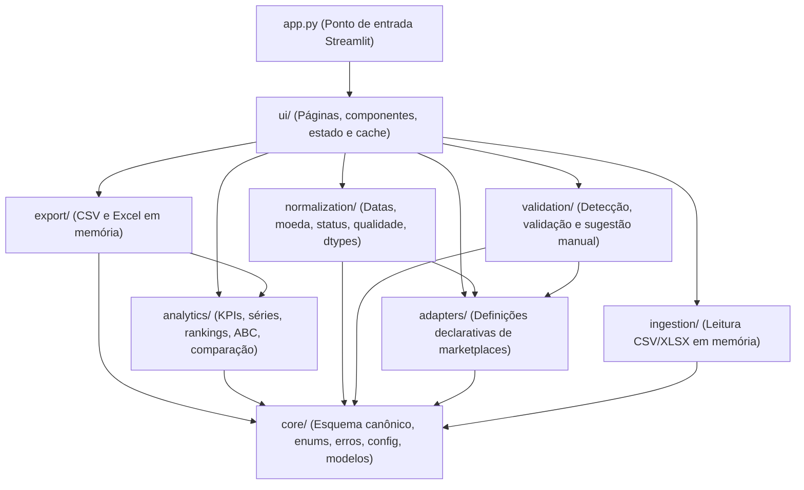
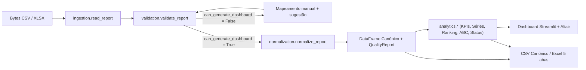

# Arquitetura — Analisador de Relatórios de Marketplaces

Este documento descreve a organização em camadas em `src/analisador/`, o fluxo de transformação de dados, o contrato do esquema canônico, o gerenciamento de estado na interface e as decisões estruturais que garantem privacidade e extensibilidade.

---

## 1. Camadas e regras de dependência

As dependências apontam sempre para o núcleo (`core/`). Nenhuma camada interna conhece camadas externas nem bibliotecas de apresentação.

### Restrições arquiteturais garantidas

1. Somente `app.py` e `src/analisador/ui/` importam `streamlit`.
2. `core/` não importa nenhum outro módulo interno do pacote `analisador`.
3. `analytics/` consome exclusivamente `core/` e não conhece adapters ou nomes de marketplace.
4. `export/` depende apenas de `core/` e `analytics/`.
5. Toda regra específica de layout de plataforma vive isolada como dado declarativo em `adapters/`.
6. Todos os módulos em `src/analisador/`, `app.py` e `scripts/` mantêm no máximo `300` linhas, com funções de até `30` linhas, aninhamento até `3` níveis e complexidade ciclomática `<= 10`.

---

## 2. Responsabilidade de cada camada

| Camada | Localização | Responsabilidades principais |
|---|---|---|
| **Núcleo** | `src/analisador/core/` | Constantes e limites operacionais (`config.py`), enums de domínio (`enums.py`), hierarquia tipada `ReportError` (`errors.py`), modelos imutáveis (`models.py`) e esquema canônico (`schema.py`). |
| **Entrada** | `src/analisador/ingestion/` | Validação de tamanho/extensão, detecção de encoding (`UTF-8`, `UTF-8 BOM`, `UTF-16`, `cp1252`/`Latin-1`), separador (`,`, `;`, `\t`), busca de cabeçalho com pré-metadados (`HEADER_SCAN_MAX_ROWS = 30`) e listagem/leitura de abas `.xlsx`. |
| **Adapters** | `src/analisador/adapters/` | Contrato imutável `MarketplaceAdapter`, normalização de cabeçalhos/status, registro (`registry.py`) e definições declarativas (`mercado_livre.py`, `shopee.py`). |
| **Validação** | `src/analisador/validation/` | Pontuação de similaridade contra adapters, diagnóstico de colunas ausentes/extras, inferência de tipo por amostra (`types.py`), sugestão automática de mapeamento (`suggestions.py`) e trava `ensure_can_generate_dashboard`. |
| **Normalização** | `src/analisador/normalization/` | Parsers vetorizados de moeda BRL/US em centavos (`currency*.py`), datas BR/ISO/extenso (`dates.py`), quantidades/status/derivação de receita líquida (`fields.py`), relatório de qualidade com outliers IQR (`quality.py`) e compactação de tipos (`dtypes.py`). |
| **Análises** | `src/analisador/analytics/` | Filtros de período/status e chave única de pedidos (`filters.py`), helpers vetorizados (`_grouping.py`), KPIs e distribuição de status (`kpis.py`), séries temporais (`timeseries.py`), ranking e Curva ABC (`products.py`) e comparação entre períodos (`comparison.py`). |
| **Exportação** | `src/analisador/export/` | CSV canônico vetorizado com BOM opcional (`csv_exporter.py`) e workbook Excel formatado em 5 abas (`excel_exporter.py`, `excel_sheets.py`). |
| **Interface** | `app.py` e `src/analisador/ui/` | Navegação multipágina (`Analisar`, `Formatos suportados`, `Como exportar`, `Sobre`), máquina de estados explícita (`state.py`), orquestração com cache isolado (`services.py`), tradução amigável de erros (`errors.py`) e gráficos Altair (`charts.py`). |

---

## 3. Fluxo de dados ponta a ponta

---

## 4. Esquema canônico e precisão financeira

Após a etapa de normalização, qualquer planilha (Mercado Livre, Shopee ou genérica) é projetada nas **12 colunas canônicas** definidas em `CANONICAL_COLUMNS` (`core/schema.py`), descartando automaticamente colunas extras com dados pessoais (CPF, e-mail, comprador, endereço):

| Coluna | Tipo em memória | Obrigatoriedade | Observação |
|---|---|---|---|
| `order_id` | `string` | Opcional | Gera identificador sintético `SYN-...` quando ausente para preservar contagem de pedidos. |
| `order_date` | `datetime64[us, America/Sao_Paulo]` | Obrigatória | Parsers aceitam BR, ISO com/sem timezone e data por extenso PT/ES. |
| `status` | `category` | Opcional | Mapeada para `OrderStatus` (`concluido`, `cancelado`, `devolvido`, `em_andamento`, `outro`). |
| `product_name` | `category` ou `string` | Obrigatória | Compactada para `category` quando cardinalidade `<= 50%` das linhas. |
| `sku` | `category` ou `string` | Opcional | Compactada para `category` quando repetitiva. |
| `quantity` | `int32` (ou `int64`) | Obrigatória | Inteiros positivos (`>= 1`). |
| `unit_price` | `Int64` | Condicional | Armazenada em **centavos inteiros**. |
| `gross_revenue` | `int64` | Obrigatória | Centavos inteiros; derivada de `quantity * unit_price` quando ausente. |
| `fees` | `Int64` | Opcional | Centavos inteiros em valor absoluto. |
| `shipping_cost` | `Int64` | Opcional | Centavos inteiros em valor absoluto. |
| `net_revenue` | `Int64` | Opcional | Centavos inteiros; informada ou derivada (`gross - fees - shipping`) com transparência via `NetRevenueSource`. |
| `marketplace` | `category` | Obrigatória | Identificador do adapter selecionado ou `generico`. |

Armazenar valores monetários como **centavos inteiros** elimina erros de ponto flutuante (`float`), convertendo para `Decimal` com arredondamento `ROUND_HALF_UP` apenas na materialização de métricas e planilhas de saída.

---

## 5. Estados da interface, cache e privacidade

### Máquina de estados (`ui/state.py`)

O fluxo sequencial é controlado pelo enum `WorkflowStage`:

1. `aguardando_arquivo`: nenhum relatório carregado em `st.session_state`.
2. `validacao_pendente`: arquivo lido, porém `can_generate_dashboard` é `False` (exige ajuste de formato ou mapeamento manual completo).
3. `validado`: colunas obrigatórias garantidas; botão **Gerar dashboard** habilitado.
4. `dashboard_liberado`: normalização concluída; filtros, gráficos e botões de exportação visíveis.

### Cache seguro sem re-hashing (`ui/services.py`)

- `compute_dashboard_bundle_cached` recebe `_canonical_df` (prefixo `_` impede re-hashing do `DataFrame` completo a cada interação nos filtros) e `cache_key` gerado por `build_dashboard_cache_key()`.
- `cache_key` combina um nonce aleatório por sessão (`STATE_SESSION_NONCE`), a assinatura SHA-256 dos bytes enviados (`STATE_UPLOAD_SIGNATURE`), o formato escolhido, a aba selecionada e o mapeamento manual — evitando colisão ou vazamento de cache entre sessões simultâneas.
- O cache possui teto de `16` entradas e TTL de `300s`.

### Tratamento de erros e privacidade

- Erros previstos herdam de `ReportError` (`core/errors.py`) e carregam mensagem e sugestão acionável em português.
- Exceções inesperadas são convertidas por `translate_exception()` em mensagem genérica segura; apenas `module.ClassName` é registrado no logger, nunca mensagens da exceção nem dados do arquivo.
- A suíte `tests/unit/test_privacy_and_logs.py` executa o pipeline completo em nível `DEBUG` com strings canário de PII para assegurar ausência de vazamentos e zero gravação em disco.
